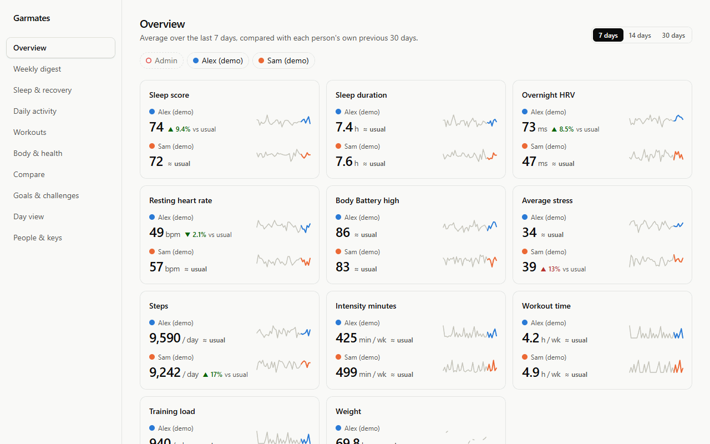
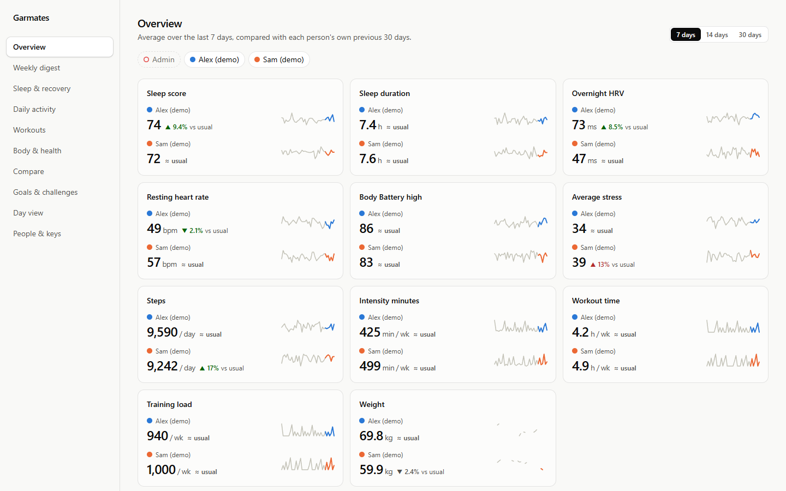
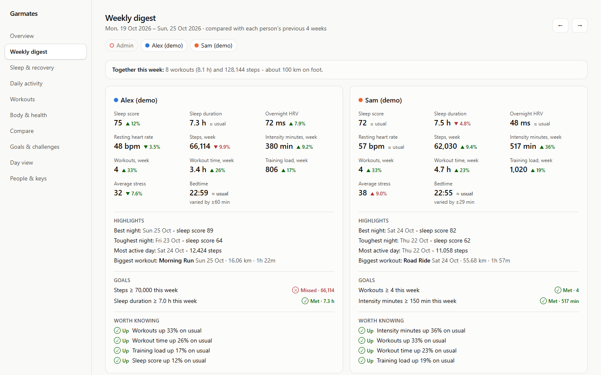
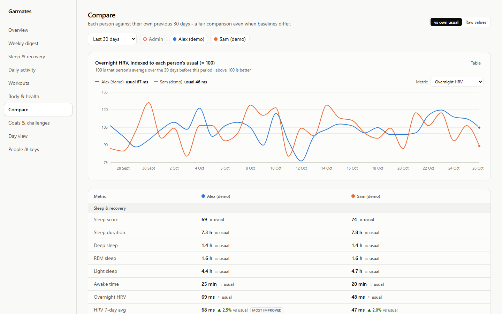
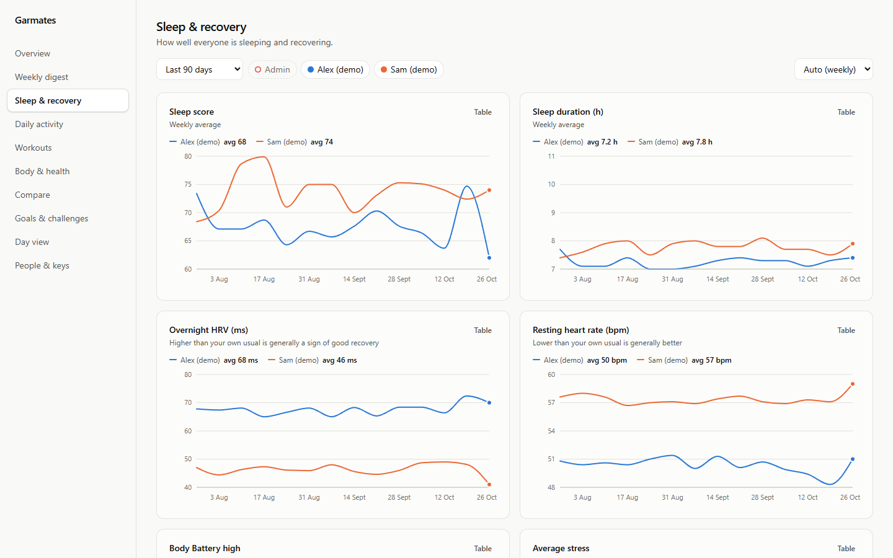
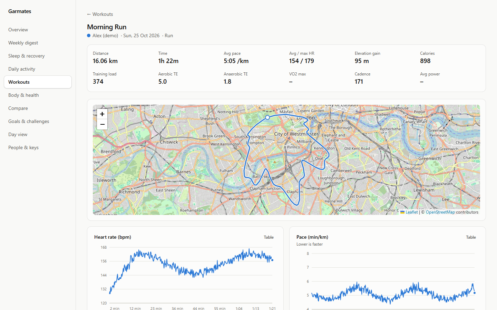
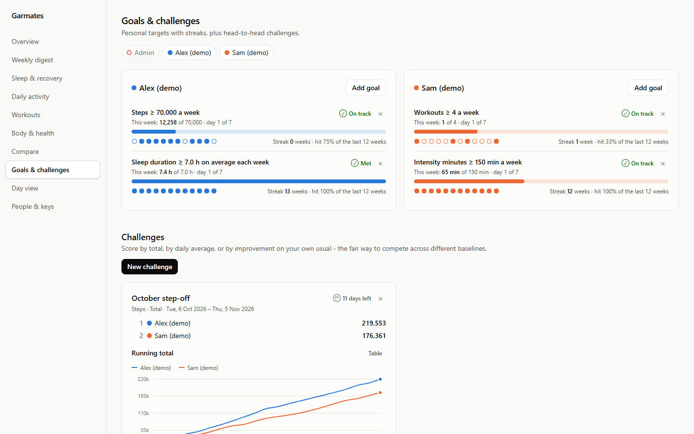
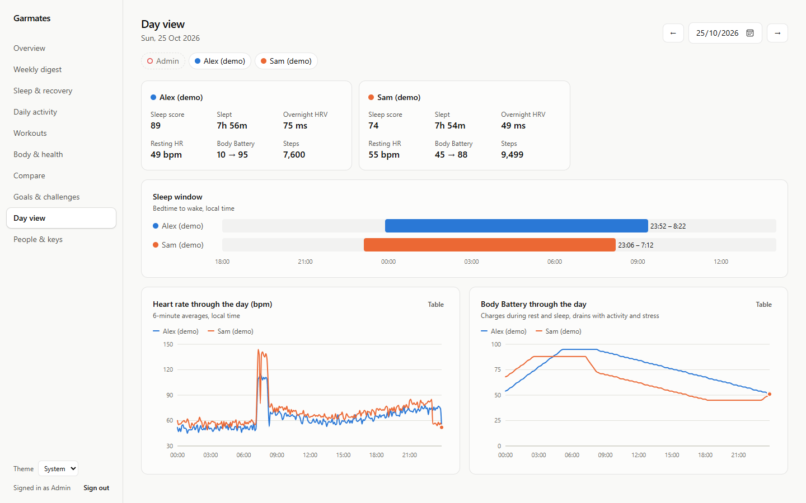
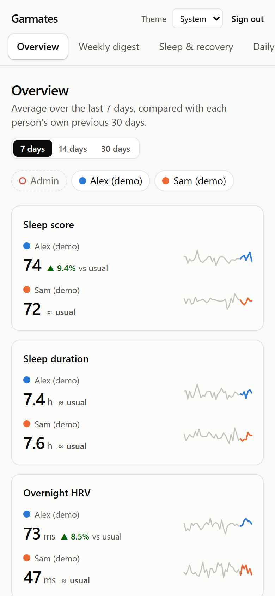

<div align="center">


# Garmates

**Your Garmin stats, side by side with the people you live with.**

A self-hosted dashboard for couples, families and housemates. It uses Garmin's official
Personal API, runs on your own PC or Raspberry Pi, and keeps everyone's data at home.

[](https://github.com/Jamesemf/garmates/actions/workflows/ci.yml)
[](https://github.com/Jamesemf/garmates/releases)
[](LICENSE)
[](backend/pyproject.toml)
[](https://github.com/Jamesemf/garmates/pkgs/container/garmates)

[Quick start](#quick-start) · [Screenshots](#screenshots) · [Install guide](docs/installation.md) · [Extending](docs/extending.md) · [Contributing](CONTRIBUTING.md)

<sub>An independent open-source project, not affiliated with or endorsed by Garmin.</sub>

</div>

<p align="center"></p>

## Why Garmates

Garmin Connect is built for one person. Garmates is built for the household: did we both
sleep worse this week? Who's ahead in this month's step challenge? Does my HRV drop after late
nights the way yours does?

- **Made for two or more.** Everyone connects their own Garmin account, then you compare sleep,
  recovery, activity, workouts and body metrics side by side. Use raw values, or each person
  against their own usual, so different baselines still make a fair comparison.
- **Official API, your own key.** Garmates uses Garmin's
  [Personal API](docs/garmin-personal-api.md) and its official client. Nobody shares a password,
  and there's no scraping or unofficial endpoints that break overnight.
- **Private by design.** It runs on a machine in your home and stores data in a local SQLite file.
  There's no cloud and no telemetry. Each person chooses which categories the others can see, and
  the server enforces it. Keys are encrypted at rest.
- **Insights you can trust.** The weekly digest compares each person's week with their previous
  four. Patterns ("you sleep better after workout days") only appear with enough nights and a
  clear effect size, and they're worded as associations, never as medical advice.
- **Runs anywhere.** Prebuilt Docker images for amd64 and arm64 cover a PC, a NAS or a Raspberry
  Pi 4/5. There's optional HTTPS for the home network, and a one-command start on Windows.

## What's in it

| Page | What it shows |
|---|---|
| **Overview** | Each person's last 7, 14 or 30 days against their own usual, with sparklines |
| **Weekly digest** | The week against the previous four, highlights, goal results, and patterns in your own data |
| **Sleep & recovery** | Sleep score, duration and stages, overnight HRV, resting HR, Body Battery, stress, bedtime and wake time |
| **Daily activity** | Steps, intensity minutes, calories, distance, floors |
| **Workouts** | Volume by sport, HR zones, estimated acute/chronic load, and activity pages with GPS maps and HR/pace charts |
| **Body & health** | Weight, body fat, BMI, Pulse Ox, respiration, hydration, fitness age |
| **Compare** | A head-to-head table, and any metric indexed to each person's baseline |
| **Goals & challenges** | Personal targets with streaks, and household challenges scored by total, average or improvement |
| **Day view** | One date side by side: sleep windows, intraday heart rate and Body Battery |
| **People & keys** | Garmin keys and expiry warnings, sync status, sharing, logins, and units (km/mi, kg/lb/st, 12/24 h) |

## Screenshots

<picture>
  <source media="(prefers-color-scheme: dark)" srcset="docs/images/overview-dark.png">
  
</picture>
<p align="center"><sub><b>Overview:</b> everyone's week against their own usual (follows your light or dark theme)</sub></p>

<table>
  <tr>
    <td width="50%"><br><sub><b>Weekly digest:</b> the week against your usual, highlights and goals</sub></td>
    <td width="50%"><br><sub><b>Compare:</b> any metric indexed to each person's own baseline</sub></td>
  </tr>
  <tr>
    <td><br><sub><b>Sleep & recovery:</b> scores, HRV and resting HR over time</sub></td>
    <td><br><sub><b>Workouts:</b> routes, heart rate and pace from the original FIT file</sub></td>
  </tr>
  <tr>
    <td><br><sub><b>Goals & challenges:</b> streaks and a friendly leaderboard</sub></td>
    <td><br><sub><b>Day view:</b> one day, side by side</sub></td>
  </tr>
</table>

<p align="center"><br><sub>Works on your phone too. Everyone opens it from their own device.</sub></p>

<sub>All screenshots use the built-in synthetic demo profiles.</sub>

## Quick start

You need [Docker](https://docs.docker.com/get-docker/). This works on Windows, macOS, Linux and a
Raspberry Pi.

```bash
git clone https://github.com/Jamesemf/garmates.git
cd garmates
```

Create a `.env` file in that folder containing your time zone, e.g. `TZ=Europe/London`, so
"today" means your local day. It defaults to UTC. Then start it:

```bash
docker compose up -d
```

Open `http://<this-machine's-IP>:8000` and create the first account (it becomes the admin).
Then:

1. Create a Personal API key at
   [Garmin Connect → Settings → Personal API Token](https://connect.garmin.com/app/settings/personalApiToken).
   Garmin shows it only once.
2. On **People & keys**, paste it into your card. Recent days appear within seconds, and a year
   of history fills in over the next few minutes.
3. **Add someone**, give them a login, and they add their own key from their own device.

**Just looking?** You don't need a Garmin account. Run it with one command:

```bash
docker run -d -p 8000:8000 -v garmates-data:/data ghcr.io/jamesemf/garmates
```

Create an account and press **Load demo profiles** for two synthetic people with eight months of
data.

The [install guide](docs/installation.md) covers the rest:

- a Raspberry Pi set up with HTTPS
- Windows without Docker (`start.cmd`)
- macOS or Linux from source
- updates, backups, and moving to a Pi

## How it works

```
Garmin Personal API ──(per-person key → 24h token)──► sync engine ──► SQLite
                                                          │   raw JSON kept verbatim
                                                          ▼
                            React app ◄── FastAPI (/api/…) ◄── normalised tables
```

The pieces:

- **Sync:** every 3 hours, plus *Sync now*. It respects Garmin's per-request date limits, shows
  recent days first, then backfills history and resumes if interrupted.
- **Raw payloads:** every Garmin response is stored verbatim, so a parser fix plus
  `garmates reparse` corrects your whole history without calling Garmin again.
- **One process:** FastAPI, SQLite and the built React app (Recharts, Leaflet/OpenStreetMap,
  Tailwind) run together. It's light enough for a Pi.

More detail is in [docs/architecture.md](docs/architecture.md).

<details>
<summary><b>Commands</b></summary>

| Command | What it does |
|---|---|
| `garmates serve [--host H] [--port P] [--reload]` | Run the dashboard |
| `garmates sync [--person ID]` | Sync now, in the foreground |
| `garmates reparse [--person ID]` | Rebuild tables from stored Garmin responses |
| `garmates verify [--person ID]` | Data-quality report: coverage, gaps, out-of-range values, raw formats |
| `garmates demo [--remove]` | Add or remove the synthetic demo profiles |
| `garmates reset-password USERNAME` | Recover a locked-out account |
| `garmates --data-dir PATH …` | Use a different data directory |

In Docker, prefix them with `docker compose exec dashboard`. Settings are environment variables
or `.env`; see [docs/configuration.md](docs/configuration.md).

</details>

## Extending it

Garmates is meant to be easy to build on:

- **A new chart or comparison** is often a single catalog entry. Every metric is defined once in
  `catalog.py` and shows up in Compare, Goals and Challenges automatically.
- **A new Garmin dataset** gets chunked sync, backfill, raw storage and resume from one
  `RangeDataset` entry.
- **A local JSON API** with interactive docs is at `/api/docs`, which is handy for Home
  Assistant or your own scripts.

[docs/extending.md](docs/extending.md) has step-by-step recipes for metrics, Garmin fields,
datasets, pages and insights.

## Roadmap

Ideas that would make good contributions:

- A banner when someone's watch hasn't synced for a while, and scheduled backups
- Strength-training analysis (sets, volume and muscle groups from FIT files)
- Day tags (travel, illness, alcohol) and their effect on sleep and HRV
- A DIY readiness score, since the Personal API doesn't provide Garmin's
- An installable PWA, and code-splitting for faster first loads
- More Garmin datasets: weight goals, wellness activity summaries, and opt-in cycle tracking
- A Home Assistant integration

See [open issues](https://github.com/Jamesemf/garmates/issues) or start a
[discussion](https://github.com/Jamesemf/garmates/discussions).

## Contributing

Bug reports, data quirks, ideas and pull requests are all welcome. [CONTRIBUTING.md](CONTRIBUTING.md)
gets you set up in a few minutes with demo data, no Garmin key needed. Please follow the
[Code of Conduct](CODE_OF_CONDUCT.md), and report security issues privately as described in
[SECURITY.md](SECURITY.md).

## Acknowledgements

Garmates is built on Garmin's official
[`garmin-connect-personal-api-python`](https://github.com/garmin/connect-personal-api-python)
client, [FastAPI](https://fastapi.tiangolo.com), [SQLAlchemy](https://www.sqlalchemy.org),
[fitdecode](https://github.com/polyvertex/fitdecode), [React](https://react.dev),
[Recharts](https://recharts.org), [Leaflet](https://leafletjs.com) with
[OpenStreetMap](https://www.openstreetmap.org/copyright) tiles, [Tailwind CSS](https://tailwindcss.com)
and [Caddy](https://caddyserver.com).

## License and disclaimer

[MIT](LICENSE) © 2026 James Ford.

Garmates is an independent project. It is not affiliated with, endorsed by or sponsored by
Garmin Ltd. or its subsidiaries. Garmin and Garmin Connect are trademarks of Garmin Ltd. or its
subsidiaries. Each user connects their own account under Garmin's terms.

Garmates is not a medical device. It shows your own data for information only, and its insights
are associations, not diagnoses or advice.
